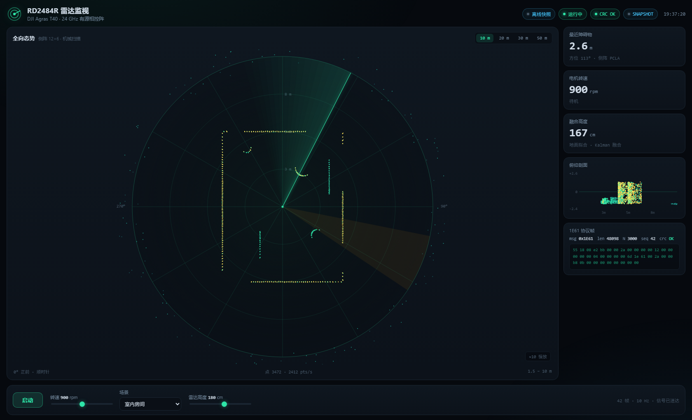

# RD2484R 雷达监控系统（T40 / DJI Agras）

大疆 T40 农业无人机 **RD2484R 24 GHz 有源相控阵雷达**的前后端监控系统。
零第三方依赖（纯 Python 标准库 + 原生 JS），模拟数据源与真机 UDP 数据源共用同一套协议栈，
**接上真雷达时只需改一个启动参数**。

> 协议逆向参考 [leommxj/dji-agras-radar](https://github.com/leommxj/dji-agras-radar)（作者公开了
> CAN/DUML、UDP V1/V2 帧格式与内存导出脚本）。本工程是独立实现，未复制其代码。
>
> 📘 **完整工作流（购物清单 / 接线教程 / 部署 / 协议 / 排错）见 [docs/WORKFLOW.md](docs/WORKFLOW.md)。**

---

## 1. 它长什么样



左侧极坐标 PPI（16 dB 分档点云 + 扫描线 + 扇区告警），右侧最近障碍物 / 电机转速 /
融合高度 / 俯仰剖面 / 1E61 实时协议帧，底部启停、转速、场景、高度、量程控制。

---

## 2. 快速开始

```bash
cd t40-radar
python run.py                 # 模拟模式，http://127.0.0.1:8000
python run.py --open          # 顺便打开浏览器
python run.py --host 0.0.0.0  # 局域网可访问（手机/别的电脑）
python run.py --port 8010     # 换端口
```

Python 3.8+，不需要 `pip install` 任何东西。

### 三种数据源

| 模式 | 命令 | 说明 |
|---|---|---|
| 内置模拟 | `python run.py` | 后端自己造点云，走完整协议栈 |
| 外部 UDP | `python run.py --source udp` | 监听 `0.0.0.0:40204`，解析真实 V2/1E61 |
| 离线快照 | 浏览器加 `?snapshot=30` | 不连 SSE，一次拉 N 帧，用于截图/演示 |

---

## 3. 真雷达到了之后

雷达上电后跑的是它自己的 Linux（Zynq），**它不会向你发送任何数据** ——
它原本是发给飞控的。所以需要一边扮演飞控（CAN + UDP 服务端），一边收数据。

完整链路（与原作者博文一致）：

```
雷达(Zynq) --WiFi radar_wifi--> 你的 Linux(ath6kl 驱动 + hostapd, 192.168.8.1)
    ^                                    |
    |--- CAN 1 Mbit (0x0A2 / 0x0A3) ------|  假飞控：发心跳/电机指令
    |--- UDP 50007 (V1 控制面) -----------|
    |--- UDP 40204 (V2 上行 1E61) ------->|  本工程 --source udp 就监听这里
```

要点：

1. **必须**用能跑 Linux 的机器（虚拟机可以，但 USB 要直通），Windows 原生不行 ——
   AR1021x 网卡全球只有 Linux `ath6kl` 驱动，CAN 也需要 SocketCAN。
2. 网卡驱动用 `ar1021x_driver/`（作者的 out-of-tree ath6kl，6 处修改），固件放
   `/lib/firmware/ath6k/AR6004/hw3.0/`。
3. 起 AP：`setup/start_ap.sh`，`hostapd.conf` 里 `ignore_broadcast_ssid` **必须注释掉**。
4. 电机不转 = 没有数据。编码器是物理线直连 FPGA 的，`--sim-esc` 只能骗状态机，
   不会产生任何回波。转速用 `duml_can_tool.py` 设（上电默认 60 rpm，上限 1800）。
5. 拿到数据后，本工程只改 `--source udp` 即可，协议层与前端零改动。

> ⚠️ 900–1800 rpm 的旋转体必须先固定，作者实测 1800 rpm 时雷达会"飞出去"。

---

## 4. 协议实现

线格式（`backend/protocol/`）：

**V2 帧**（UDP 40204，雷达 → 飞控，27 B 头 + payload + 2 B CRC16）

```
+0       0x55 SOF
+1       低 6 位 = 0x18
+2       (byte2 & 0xFC) == 0x08
+3..4    u16 total_len（含头与 CRC）
+7..10   u32 seq
+12..13  endpoint1（perception = 0x0012）
+18..19  endpoint2（perception = 0x0004）
+23      header CRC8（覆盖 +0..+22）
+24..25  msg，大端（0x1E61）
+27..    payload
-2..-1   CRC16
```

**0x1E61 perception payload** = 69 B 头 + N × 16 B 记录

```
头  +3..4   记录数 N (u16)
头  +65..66 subtype：0=ground / 1=wire / 2=pcla
记录 <H f f f H> = id(u16), x(f32), y(f32), z(f32), metric(u16)
                  body 坐标系：前 x / 右 y / 上 z，单位 m
                  metric = 置信度 × 65535
```

**0x1E62 避障结果**（116 B）：16 个扇区项（方位/仰角/距离）+ 卡尔曼高度 + 融合高度 + 置信度。

**CRC**：CRC8 反射 poly `0x8C` init `0x77`；CRC16 反射 poly `0x8408` init `0x3692`。
表在 `backend/protocol/crc_tables.py`（从原作者的 ROM 表抽取），
`tools/radar_udp_sender.py` 里用算法生成同一张表并做了逐字节校验。

`GET /api/protocol` 会返回当前帧的 hex，方便和真机抓包对照。

---

## 5. 目录

```
run.py                       启动入口
backend/
  app.py                     RadarApp（tick 线程 / SSE 广播 / UdpSource / ingest_udp）
  server.py                  ThreadingHTTPServer + SSE + 控制 API
  protocol/                  V1/V2 帧、1E61/1E62、CRC
  sim/radar.py               模拟器：场景几何 + 射线投射 + 扫描
frontend/                    index.html / style.css / app.js（无框架、无构建）
tools/radar_udp_sender.py    单文件 UDP 上行发送器（树莓派/Linux 可跑）
docs/shot-sim.png            界面截图
```

### HTTP 接口

| 方法 | 路径 | 说明 |
|---|---|---|
| GET | `/` | 页面 |
| GET | `/events` | SSE 帧流 |
| GET | `/api/state` | 当前状态 JSON |
| GET | `/api/protocol` | 最近一帧协议字段 + hex |
| GET | `/api/snapshot?n=30` | 合成 N 帧（离线快照） |
| POST | `/api/control` | `{action: start\|stop\|toggle\|rpm\|scene\|height, value}` |

---

## 6. 模拟器物理约定

- 地面恒在 `z = -h`（h 为雷达离地高度）。只有俯仰角 ≤ 10° 的地面进波束，
  所以近端从 `r_min = h / tan(10°)` 开始（h=1.8 m 时约 10 m）。
- 每帧扫过 `sweep = clamp(rpm × 6 × dt × 0.35, 6°, 90°)` 的扇区；900 rpm @10 fps 约 60°。
- 每帧约 50–64 条射线 + 60 个地面点，编码成 1E61 后做一次完整往返解析校验。
- 高度 < 160 cm 且 running 时，前端会提示"低于 1.6 m 门限，避障被清零"（真机行为）。

---

## 7. 已知限制

- 只实现了**接收**（1E61/1E62）。假飞控的 V1 控制面（50007）与 CAN DUML 不在本工程内，
  真机联调时仍需作者的 `radar_min_client.py` 或等价实现。
- 不带录制/回放（可作为下一步：把 `/events` 落 JSONL 再回放）。
- 顶面 4×4 阵的原始热图不在网络协议里，只能从雷达进程内存读，本工程未涉及。

---

## 8. 排错

| 现象 | 原因 |
|---|---|
| 页面打开全空 | 端口被占 / 后端崩了，看终端 traceback |
| SSE 一直"连接中" | 反向代理缓冲了 `text/event-stream`，或防火墙拦了 |
| `--source udp` 收不到 | 发送端没发到 `40204`，或被 Windows 防火墙拦（首次会弹窗） |
| 手机连不上电脑 | `run.py` 要用 `--host 0.0.0.0`，且同一局域网 |
| 点云挤在 0°/180° | 扫描角推进用了物理转速（已修，见 `sim/radar.py` 注释） |
